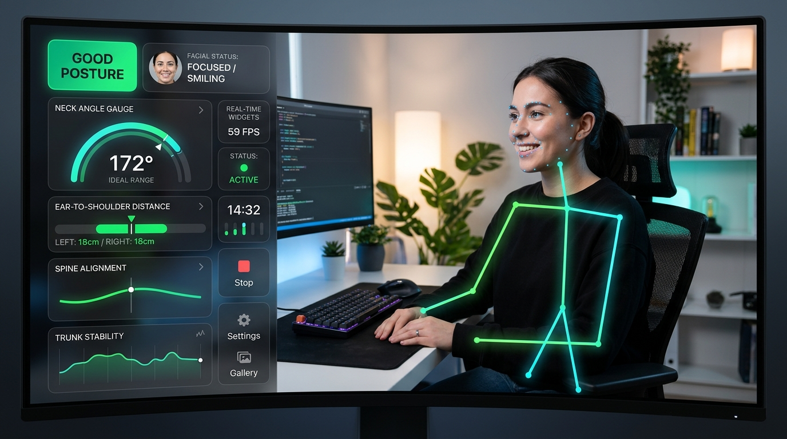
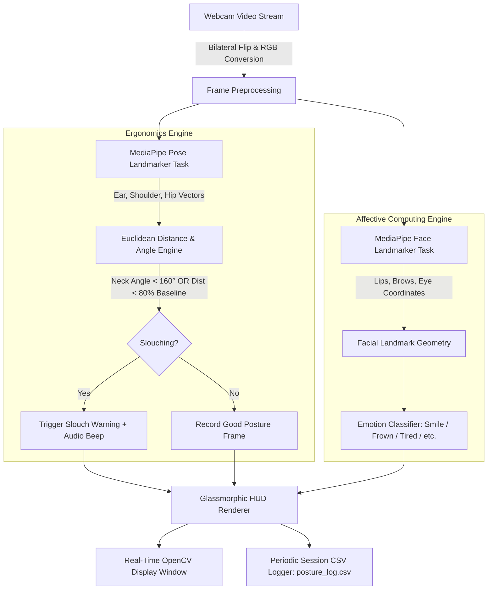

<div align="center">

# 🧘 AI Posture Coach & Facial Expression Tracker

### *Real-Time Computer Vision Ergonomic Assistant for Developers & Desk Workers*

[](https://www.python.org/)
[](https://opencv.org/)
[](https://developers.google.com/mediapipe)
[](https://opensource.org/licenses/MIT)
[]()
[]()

<br/>



<br/>

**AI Posture Coach** monitors spinal alignment, neck inclination, and emotional facial expressions in real-time through your webcam. Designed specifically for programmers, designers, and remote professionals, it actively detects slouching, issues non-intrusive ergonomic feedback, and tracks session health without requiring external sensors or wearable hardware.

</div>

---

## 🌟 Key Highlights & Capabilities

| Feature | Description | Tech Implementation |
| :--- | :--- | :--- |
| **🪑 Bilateral Posture Tracking** | Continuous surveillance of neck inclination angle and ear-to-shoulder euclidean distance with automatic left/right profile fallback. | MediaPipe Pose Landmarker (BlazePose) |
| **😊 Facial Emotion Analysis** | Classifies 6 emotional and fatigue states: *Smiling, Frowning, Surprised, Angry, Tired, Neutral*. | MediaPipe Face Landmarker (478 pts) |
| **🖥️ Glassmorphic HUD Dashboard** | High-tech translucent overlay displaying dynamic posture pills, live telemetry bars, FPS, and session timer. | OpenCV + Alpha Blended Canvas |
| **🔔 Smart Audio Feedback** | Timed, non-intrusive alert tones triggered when poor posture persists, with customizable cooldown & mute toggle. | Windows `winsound` / POSIX terminal bell |
| **🎯 One-Touch Calibration** | Instant baseline calibration tailored to individual desk heights, torso lengths, and camera perspectives. | Euclidean normalizer (`[C]` key) |
| **📊 Telemetry Logging** | Automatically logs posture state, emotion, angles, distances, and ergonomic scores into structured CSV data. | Real-time CSV logger every 10s |

---

## 🏗️ System Architecture & Workflow

The coach runs a synchronized, high-throughput computer vision pipeline operating at ~30–60 FPS:



---

## 📐 Mathematical Formulation & Detection Logic

### 1. Ear-to-Shoulder Distance ($d$)
Calculates normalized 2D Euclidean distance between the ear keypoint ($p_1$) and shoulder keypoint ($p_2$):

$$d = \sqrt{(x_2 - x_1)^2 + (y_2 - y_1)^2}$$

*Slouch Condition:* If $d < (\text{baseline\_distance} \times 0.80)$, the head is dropping forward or collapsing toward the torso.

### 2. Neck Inclination Angle ($\theta$)
Calculates the 3-point planar angle at vertex $p_2$ (Shoulder) formed by rays towards $p_1$ (Ear) and $p_3$ (Hip):

$$\vec{v}_1 = p_1 - p_2, \quad \vec{v}_2 = p_3 - p_2$$

$$\cos(\theta) = \frac{\vec{v}_1 \cdot \vec{v}_2}{\|\vec{v}_1\| \|\vec{v}_2\|}$$

$$\theta = \arccos\left(\text{clamp}(\cos(\theta), -1.0, 1.0)\right) \times \frac{180^\circ}{\pi}$$

*Slouch Condition:* If $\theta < 160.0^\circ$, forward head posture (tech neck) is flagged. If the hip landmark is outside the camera viewport, an adaptive vertical torso vector is used as fallback.

---

## 😊 Facial Expression & Fatigue Matrix

| Expression | Primary Landmark Criteria | Ergonomic Insight |
| :--- | :--- | :--- |
| **Smiling** | Average mouth corner height $< \text{Nose } Y - 0.01$ and mouth open | Relaxed, positive focus state |
| **Frowning** | Average mouth corner height $> \text{Nose } Y + 0.01$ | Frustration, mental strain |
| **Surprised** | Mouth aperture $> 10\%$ of inter-ocular eye distance | Sudden reaction or alertness |
| **Angry** | Inner eyebrow asymmetry $> 0.05$ with narrowed eye aperture | Intense cognitive concentration or stress |
| **Tired / Drowsy** | Mouth open $> 8\%$ (yawning) and both eyes narrowed $(< 0.03)$ | Break recommended (20-20-20 rule) |
| **Neutral** | Equilibrium across facial ratios | Standard working baseline |

---

## ⌨️ Interactive Controls Reference

| Key | Action | Behavior Description |
| :---: | :--- | :--- |
| <kbd>C</kbd> | **Calibrate Baseline** | Sets your current sitting posture as the optimal 100% baseline standard. |
| <kbd>L</kbd> | **Toggle Mesh** | Shows or hides the neon skeletal wireframe and face mesh dots for a cleaner view. |
| <kbd>M</kbd> | **Mute / Unmute** | Toggles audible slouch alerts on and off without interrupting video telemetry. |
| <kbd>R</kbd> | **Reset Statistics** | Resets session frame tally, slouch count, and ergonomics posture score. |
| <kbd>Q</kbd> | **Quit Application** | Safely cleans up video streams, closes MediaPipe graph handles, and exits. |

---

## 🚀 Installation & Quickstart

### 1. Clone the Repository
```bash
git clone https://github.com/OjusGupta/-AI-Posture-Coach-.git
cd -AI-Posture-Coach-
```

### 2. Setup Virtual Environment (Recommended)
```bash
# Windows
python -m venv .venv
.venv\Scripts\activate

# macOS / Linux
python3 -m venv .venv
source .venv/bin/activate
```

### 3. Install Dependencies
```bash
pip install -r requirements.txt
```

### 4. Verify MediaPipe Model Files
Ensure the pre-trained MediaPipe task models are in your root folder:
- [`pose_landmarker.task`](https://storage.googleapis.com/mediapipe-models/pose_landmarker/pose_landmarker_lite/float16/1/pose_landmarker_lite.task) *(~5.7 MB)*
- [`face_landmarker.task`](https://storage.googleapis.com/mediapipe-models/face_landmarker/face_landmarker/float16/1/face_landmarker.task) *(~3.7 MB)*

*(Both model files are already included in this repository).*

### 5. Launch the Coach
```bash
python main.py
```

> **First Run Tip:** Sit naturally in your ideal upright position, look at the screen, and press <kbd>C</kbd> to calibrate your baseline!

---

## 📁 Project Directory Structure

```text
├── assets/
│   └── posture_coach_hud_preview.png  # High-definition interface mockup
├── .gitignore                         # Python, IDE, and temporary ignore rules
├── face_landmarker.task               # Google MediaPipe face landmark model
├── main.py                            # Core detection engine & HUD application
├── pose_landmarker.task               # Google MediaPipe pose landmark model
├── posture_log.csv                    # Session telemetry history (auto-appended)
├── Project_Report.pdf                 # Comprehensive academic project report
├── Project_Report.txt                 # Project specification & architectural reflection
├── README.md                          # UI figured documentation
└── requirements.txt                   # Production package dependencies
```

---

## 📊 Telemetry Log Format (`posture_log.csv`)

Every 10 seconds, active session metrics are captured into `posture_log.csv` for long-term ergonomics analytics:

| Timestamp | Session_Elapsed_Sec | Posture_Status | Face_Status | Current_Dist | Baseline_Dist | Neck_Angle | Posture_Score_Pct | Slouch_Alert_Count |
| :---: | :---: | :---: | :---: | :---: | :---: | :---: | :---: | :---: |
| `2026-10-21 16:45:00` | `10` | `Good Posture` | `Neutral` | `0.2315` | `0.2100` | `172.40` | `100.0` | `0` |
| `2026-10-21 16:45:10` | `20` | `Good Posture` | `Smiling` | `0.2289` | `0.2100` | `168.15` | `98.5` | `0` |
| `2026-10-21 16:45:20` | `30` | `SIT UP STRAIGHT!`| `Frowning`| `0.1542` | `0.2100` | `151.30` | `91.2` | `1` |

---

## 🩺 Ergonomic Workstation Recommendations

- **Eye-Level Display:** The top third of your monitor should be at eye height to eliminate forward neck bending.
- **The 90-90-90 Rule:** Maintain a 90° angle at your elbows, hips, and knees.
- **20-20-20 Guideline:** Every 20 minutes, take a 20-second break and view an object at least 20 feet away to alleviate digital eye strain.

---

## 🔮 Future Roadmap

- [ ] **Blendshape Integration:** Enhanced facial emotion classification via 52 MediaPipe Facial Blendshapes.
- [ ] **Multi-Person Classroom Support:** Scalable pose tracking for computer labs and classroom ergonomic monitoring.
- [ ] **Interactive Streamlit Web Dashboard:** Interactive chart analytics for historical `posture_log.csv` reports.
- [ ] **Cross-Platform Audio Notifications:** Native desktop toast push notifications for background minimized mode.

---

## 📄 License & Credits

Distributed under the **MIT License**. See `LICENSE` for details.

Developed with ❤️ by **[Ojus Gupta](https://github.com/OjusGupta)**.